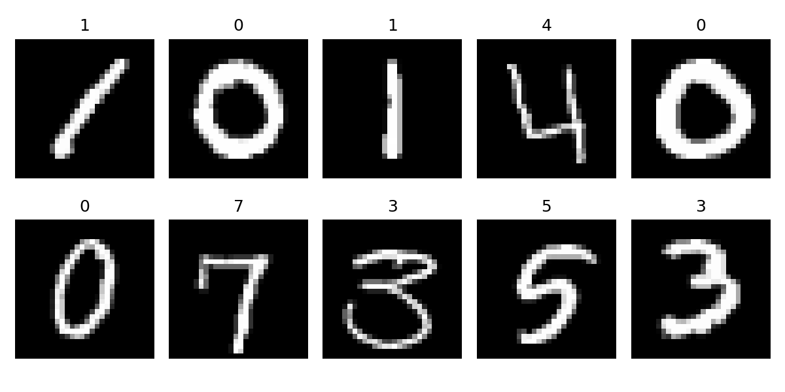
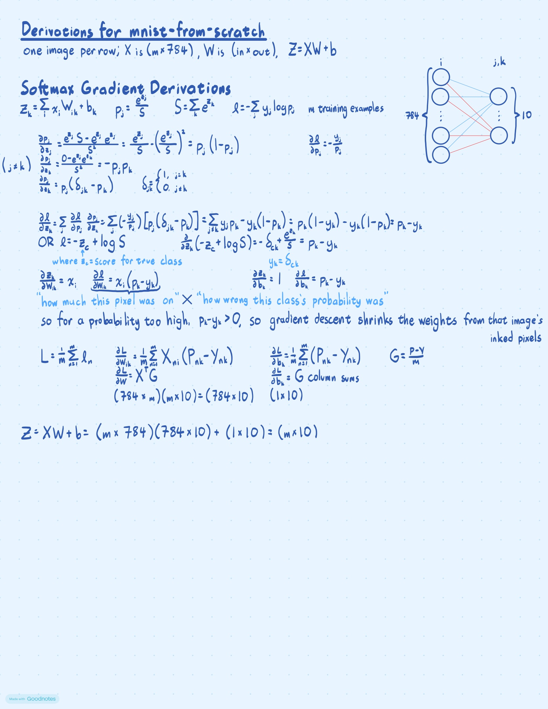
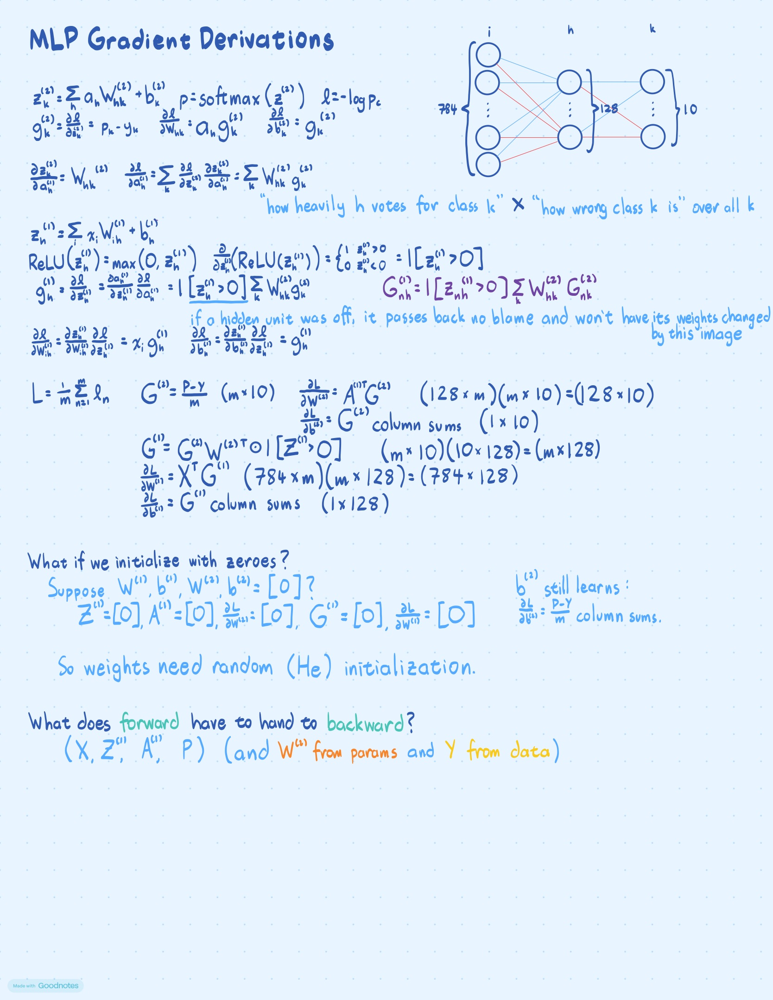
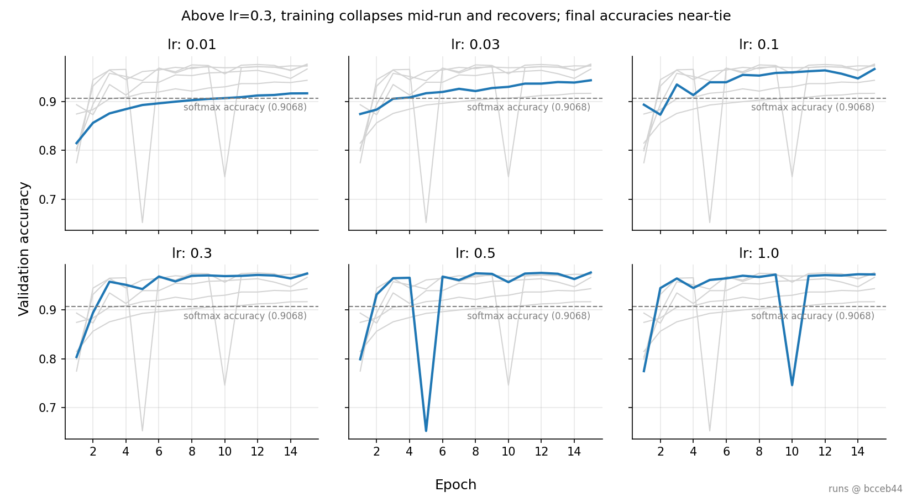
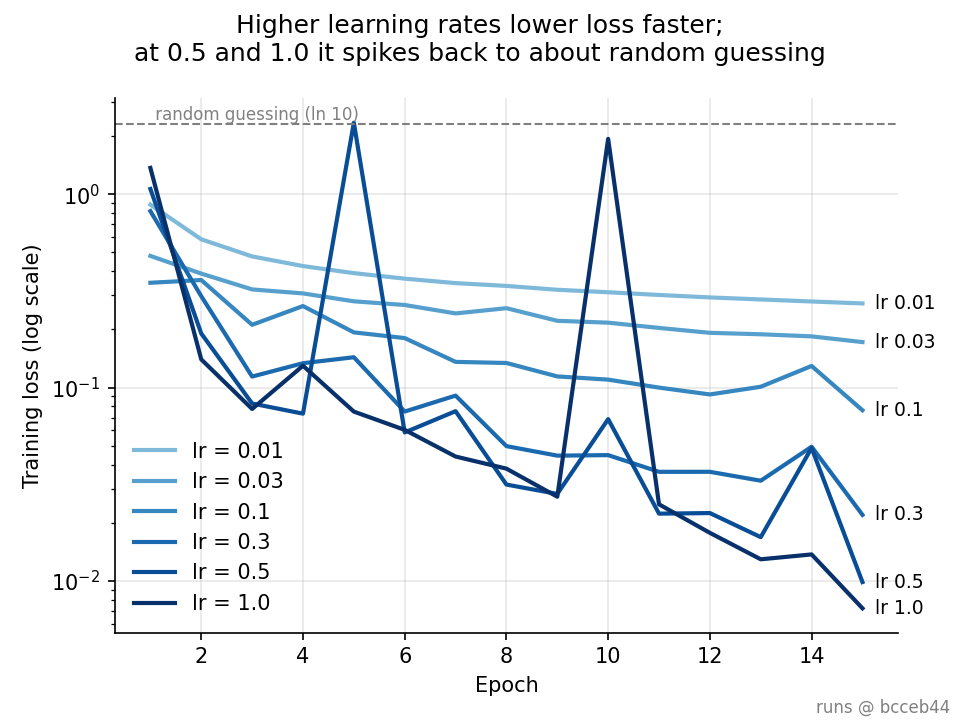

# MNIST from scratch: a two-layer neural network in NumPy

A handwritten-digit classifier built with no ML libraries: every gradient derived by hand and checked numerically. **0.973 on Kaggle's Digit Recognizer**, up from 0.908 for a softmax baseline.

## Results

| Model | Settings | Validation | Kaggle |
|---|---|---|---|
| Softmax regression (baseline) | lr 0.1, 10 epochs | 0.9068 | 0.90803 |
| MLP, 128 hidden units | lr 0.1, 15 epochs | 0.9660 | 0.96400 |
| MLP, 128 hidden units | lr 0.3, 15 epochs | 0.9738 | 0.97275 |

Gradient check: backpropagation matches finite differences to a maximum relative
error of 3.3 × 10⁻⁹.

## Data

Kaggle's [Digit Recognizer](#kaggle) uses MNIST ([LeCun et al., 1998](#lecun)):
28 × 28 grayscale images of handwritten digits.

- **Training:** 42,000 labeled images. I hold out a random 5,000 (seed 0) for validation,
  so the models train on 37,000.
- **Test:** 28,000 unlabeled images, scored by Kaggle on accuracy.
- **Preprocessing:** each image is flattened to 784 pixels and scaled from 0–255 to [0, 1].




## How it works

- **Model:** 784 → 128 (ReLU) → 10 (softmax), He initialization ([He 2015](#he)), mini-batch
  gradient descent (batch 128), cross-entropy loss.
- **Backpropagation:**
    ```py
    G2 = (P - Y)/m
    dW2 = A1.T @ G2
    db2 = G2.sum(axis=0, keepdims=True)
    G1 = (G2 @ W2.T) * (Z1 > 0)
    dW1 = X.T @ G1
    db1 = G1.sum(axis=0, keepdims=True)
    ```
- **Full derivation** I learned backpropagation from 3Blue1Brown's Neural Networks series ([3Blue1Brown](#threeblueonebrown)); the derivations below are my own, for this model.
  
  

- **Gradient check:** For five randomly chosen entries of each parameter array: nudges each entry by ±10⁻⁵ to compute slope directly with finite difference, compares it with gradient returned by `backward()`. Maximum relative error: 3.3 × 10⁻⁹.
- **Tests:** 23 tests, run with `python -m pytest -v`:
  - Data (scaling, shapes, a non-overlapping split that spans the training set, reproducibility, one-hot encoding)
  - Softmax (rows sum to 1, overflow guard, shift invariance, uniform loss = ln 10, one-step loss decreases)
  - MLP (gradient check, gradient shapes, He scale)
  - Submission (matches sample format, preserves label order)
  - Model export (exported parameters within 5 × 10⁻⁶ of original)

## Experiment: learning-rate sweep

**Question.** How does the learning rate affect how fast, and how stably, the MLP trains in 15 epochs?

**Prediction *(written before the sweep)*.** From a 15-epoch MLP run at a learning rate of 0.1, there were multiple epochs where the loss increased before continuing to decrease, and at the last few epochs the training accuracy was still increasing while validation was only slightly behind. It seemed that this learning rate overshot the local minimum and required correcting. As such, I conducted an experiment, measuring validation accuracy for learning rates of 0.01, 0.03, 0.1, 0.3, 0.5, and 1.0 and plotting validation accuracy against epoch for all six. From the initial run, 0.1 seemed to be too high of a learning rate and resulted in wobbling around the bottom of the valley, so a lower learning rate would be better. However, the training accuracy was still increasing, so I doubted a 90% slower learning rate would reach a meaningful plateau. Thus, I predicted that a learning rate of 0.03 would result in the highest validation accuracy.

**Setup.** Two-layer MLP (784 → 128 ReLU → 10 softmax), 15 epochs, batch size 128, all seeds 0.
Only the learning rate changes: 0.01, 0.03, 0.1, 0.3, 0.5, 1.0.
Runs from commit `bcceb44`; raw numbers in `results/lr_sweep/`.





| Learning rate | Validation (epoch 15) | Training (epoch 15) |
|---|---|---|
| 0.01 | 0.9164 | 0.9236 |
| 0.03 | 0.9430 | 0.9519 |
| 0.1 | 0.9660 | 0.9801 |
| 0.3 | 0.9738 | 0.9962 |
| 0.5 | 0.9760 | 0.9990 |
| 1.0 | 0.9720 | 0.9990 |

**What happened.** My predicted most-accurate learning rate of 0.03 ranked fourth in validation accuracy out of the six runs. I had assumed that bouncing around the local minimum was due to the learning rate being too large, and that a learning rate higher than 0.1 would only cause more overshooting and harm accuracy, but the run at lr=0.3 contradicted this:

| | Loss | Validation
|---|---|---|
| 0.1, epochs 12→14 | 0.092 → 0.129 (×1.4) | 0.963 → 0.947 (-1.6 points)
| 0.3, epochs 13→14 | 0.033 → 0.049 (×1.5) | 0.970 → 0.964 (-0.6 points)

In the loss, the spike appears to only be slightly bigger at 0.3. Not only that, but the accuracy drop is much smaller. This may be because a learning rate of 0.3 results in more confident predictions earlier in training. Thus, when a bad step knocks confidence down for both, the predictions from lr=0.3 are farther from the decision boundary and result in a smaller impact on accuracy. With a fixed budget of 15 epochs, it seems that the speed of increasing confidence on predictions mattered more than a smooth descent.

Within 15 epochs, the data show that smaller rates did not decrease loss as fast; 0.01 appears to still be improving through the 15th epoch, and only just beats the softmax baseline (0.916 accuracy against 0.907). On the other hand, larger rates were also prone to overshooting, as the lr=0.5 collapsed to about 0.65 accuracy at epoch five, and the lr=1.0 to 0.75 at epoch 10. In both instances, the loss jumped back to about ln 10 (similar to random guessing) before recovering. Among the higher learning rates of 0.3, 0.5, and 1.0, there is a near tie of final validation accuracy, each landing between 0.9720 and 0.9760. With 5,000 validation images, the standard error is about 0.0024, so this is within one to two standard errors. As the learning rate grew, however, the generalization gap did as well; at lr=0.3, training accuracy reaches 0.996 against 0.974 on validation, and this gap grows with learning rate. This seems to be a result of training further rather than larger step size, however, as when comparing matched training accuracies of about 0.9800:

| lr= | Epoch | Train | Validation | Gap |
|---|---|---|---|---|
| 0.1 | 15 | 0.9801 | 0.9660 | 1.41 points|
| 0.3 | 6 | 0.9788 | 0.9678 | 1.10 |
| 0.5 | 4 | 0.9792 | 0.9652 | 1.40 |
| 1.0 | 6 | 0.9805 | 0.9640 | 1.65 |

the gap is about the same for every rate. As such, it seems that the larger final gaps at high rates come from fitting further within the same 15 epochs: learning rates of 0.5 and 1.0 end at 99.9% on training.

**Caveats.**
- One seed per setting (seed 0 for the data split, initialization and epoch shuffling)
- Fixed 15-epoch budget
- One validation split
- Final accuracies show a near-tie within noise for lr=0.3, 0.5, and 1.0.

**What I would test next.** One question that the results for lr=0.1 and lr=0.3 still left me with was why a larger step settled at all, if lr=0.1 already showed overshooting. I previously had the image of stepping down a fixed valley, but after reading some of the literature on this subject, I learned that overshooting depends on the step size relative to the curvature of the area, resulting in training that may bounce out of sharp, narrow minima into wider regions that may just be flat enough for its own step size. For full-batch gradient descent, the curvature settles around 2/(step size) ([Cohen et al. 2021](#cohen)); for mini-batch SGD like mine, research has proposed a similar pattern where the curvature along each mini-batch's gradient settles there instead ([Andreyev & Beneventano, 2024](#andreyev)). With that in mind, though my setup differs on loss, data, batch size and step size, the spikes in the lr=0.5 and 1.0 runs may be moments where the stepping was too large for even one of those flat regions, thrown out before recovering elsewhere. In the future, I can measure the batch sharpness using a finite difference of gradients (similar to in the gradient check) during training to get a better picture of this "edge of stability" idea.

$$Hv \approx \frac{\nabla L_B (\theta + \epsilon v) - \nabla L_B (\theta - \epsilon v)}{2 \epsilon} \text{,} \qquad \text{curvature along } g = \frac{g^\top H g}{\lVert g \rVert^2}$$

where $\theta$ is all the network's weights, $L_B$ is the loss on one mini-batch $B$, $g = \nabla L_B(\theta)$ is that batch's gradient, $H$ is its Hessian (the matrix of second derivatives), $v$ is any direction, and $\epsilon$ is a small step, like h in the gradient check. Batch Sharpness is the right-hand quantity averaged over mini-batches. If Andreyev & Beneventano's finding extends to cross-entropy loss and my setup, then at lr=0.3 Batch Sharpness should hover near 2/0.3 ≈ 6.7 and at lr=0.1 near 2/0.1 = 20.

**What I chose, and why.** lr=0.3: Although lr=0.5 had the maximum validation accuracy of 0.9760, lr=0.3 was a close second at 0.9738 (eleven images fewer, out of 5,000), and it never collapsed; its worst loss stayed far below random guessing while lr=0.5 shows a significant spike up to about ln 10. Kaggle: 0.97275.

## Limitations
- Plain stochastic gradient descent: no momentum, schedule, regularization, or augmentation
- Trained on 37,000 images with remaining 5,000 left for validation, not all 42,000
- CPU and NumPy only (by design)
- **Context**: a well-tuned MLP on MNIST typically reaches ~98%; convolutional networks reach above 99%.

## How to run

Tested with Python 3.9.

**Setup**
```bash
git clone https://github.com/tdmdfever/mnist-from-scratch.git
cd mnist-from-scratch
python3 -m venv .venv
source .venv/bin/activate          # Windows: .venv\Scripts\activate
pip install --upgrade pip
pip install -r requirements.txt
```

**Data.** Download `train.csv`, `test.csv` and `sample_submission.csv` from the
[Digit Recognizer competition](https://www.kaggle.com/competitions/digit-recognizer/data)
(you'll need to accept its rules) into `data/`.

**Tests**
```bash
python -m pytest -v
```

**Train**
```bash
python -m src.train --model softmax --epochs 10
python -m src.train --model mlp --lr 0.3
```
Each run creates `runs/<timestamp>_<model>/` with `config.json`, `history.json`, `params.npz`,
and `submission.csv` (the file to upload to Kaggle).

**Export trained model to JSON**
```bash
python -m src.export_weights --run runs/<timestamp>_mlp
```
using any run made by the current `train.py`. Writes `params.json` next to `params.npz` in that folder.

**Redraw the plots from the saved numbers**

```bash
python -m src.plot_lr_sweep --commit bcceb44
```

**Reproduce the learning-rate sweep from scratch**
```bash
for lr in 0.01 0.03 0.1 0.3 0.5 1.0; do
    python -m src.train --model mlp --lr $lr
done
python -m src.plot_lr_sweep --runs-dir runs --commit $(git describe --always --dirty)
```
Results are identical on the same machine; on others, the last digits may differ.

## Project structure

```text
├── src/
│   ├── data.py                   loading, scaling, train/validation split, one-hot
│   ├── softmax.py                softmax regression (baseline)
│   ├── mlp.py                    two-layer network: init, forward, backward
│   ├── train.py                  training loop, run records, Kaggle submission
│   ├── plot_lr_sweep.py          the sweep's figures
│   └── export_weights.py         exporting trained model to JSON
├── tests/                        pytest suite
│   ├── test_data.py
│   ├── test_softmax.py
│   ├── test_mlp.py
│   ├── test_train.py
│   └── test_export_weights.py
├── data/                         not in the repo; put the Kaggle CSVs here
├── runs/                         not in the repo; created when you train
├── results/                      experiment results
│   └── lr_sweep/                 the raw numbers behind the figures
├── figures/                      the figures in this README
├── docs/                         the by-hand derivations in this README
├── notebooks/                    scratch exploration; made sample-digits figure
├── requirements.txt
└── pytest.ini
```

## References
- <a id="cohen"></a> Cohen, J. M., Kaur, S., Li, Y., Kolter, J. Z., & Talwalkar, A. (2021).
  *Gradient Descent on Neural Networks Typically Occurs at the Edge of Stability.* ICLR 2021.
  [arXiv:2103.00065](https://arxiv.org/abs/2103.00065)
- <a id="andreyev"></a> Andreyev, A., & Beneventano, P. (2024). *Edge of Stochastic Stability: Revisiting the
  Edge of Stability for SGD.* arXiv preprint. [arXiv:2412.20553](https://arxiv.org/abs/2412.20553)
- <a id="he"></a> He, K., Zhang, X., Ren, S., & Sun, J. (2015). *Delving Deep into Rectifiers.* ICCV 2015.
  [arXiv:1502.01852](https://arxiv.org/abs/1502.01852)  (He initialization)
- <a id="lecun"></a> LeCun, Y., Bottou, L., Bengio, Y., & Haffner, P. (1998). *Gradient-based learning applied
  to document recognition.* Proceedings of the IEEE.  (the original MNIST dataset)
- <a id="kaggle"></a> Kaggle, [Digit Recognizer](https://www.kaggle.com/competitions/digit-recognizer)  (data and scoring)
- <a id="threeblueonebrown"></a> 3Blue1Brown, *[Neural Networks](https://youtube.com/playlist?list=PLZHQObOWTQDNU6R1_67000Dx_ZCJB-3pi)*, chapters 1–4
